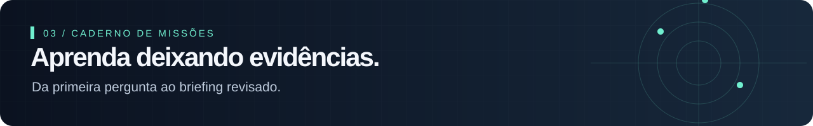

# Sua primeira sessão · 25 minutos

[← Início](README.md) · [Biblioteca](biblioteca/README.md) · [Trilha CTI](trilhas/CTI-DO-ZERO-AO-BRIEFING.md)

> Você não precisa ler toda a biblioteca. Precisa sair desta sessão com uma pergunta melhor.

| Tempo | Ação | Resultado |
|---|---|---|
| 0–5 min | Escolha uma decisão: priorizar uma coleta, uma defesa ou uma investigação. | Destinatário e decisão definidos |
| 5–10 min | Escreva um [PIR](templates/PIR.md) delimitando setor, período e escopo. | Uma pergunta respondível |
| 10–20 min | Consulte o [FIRST Curriculum](https://www.first.org/global/sigs/cti/curriculum/) e um relatório público do seu tema. | Uma evidência e uma lacuna |
| 20–25 min | Registre no [diário](DIARIO.md) o que mudou e o próximo passo. | Uma ação pequena e concreta |

## Escolha sua rota

- **CTI e OSINT:** [seis missões até o briefing](trilhas/CTI-DO-ZERO-AO-BRIEFING.md).
- **MITRE e modelagem:** [percurso por finalidade](trilhas/MITRE-EM-CONTEXTO.md).
- **Landscape e tendências:** [ler, comparar e produzir panoramas](trilhas/LANDSCAPE-E-TENDENCIAS.md).
- **Prática imediata:** [caso fictício Aurora](trilhas/CASO-AURORA.md).
- **Outras disciplinas:** [mapa completo](docs/MAPA-DISCIPLINAS.md); preserve o ritmo de uma ação por sessão.

## Ritmo sugerido, não prazo obrigatório

Três sessões semanais de 25–45 minutos: leitura, aplicação e revisão. Ao fim de cada missão, registre o artefato e a lacuna restante. O tempo necessário depende do seu conhecimento prévio.

- [ ] Defini um destinatário e uma decisão.
- [ ] Separei evidência de inferência.
- [ ] Anotei limitações da fonte.
- [ ] Escolhi uma próxima ação.
