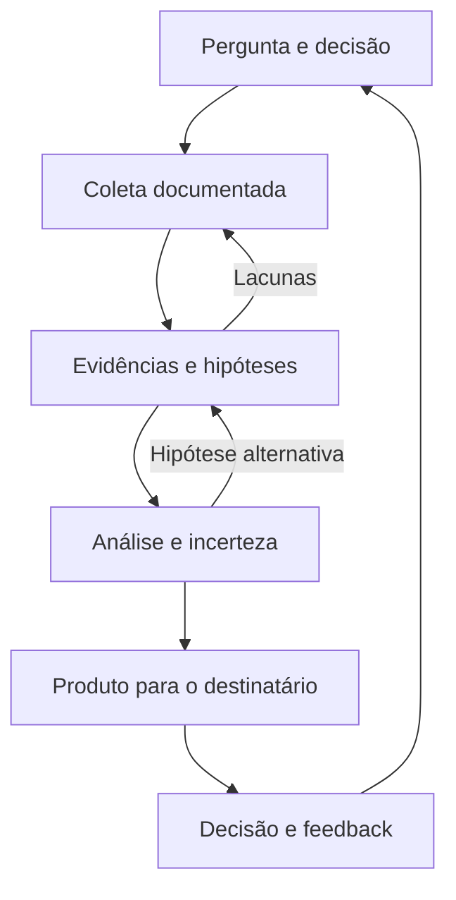

<p align="center"></p>

<p align="center">
<a href="COMECE-AQUI.md"><strong>COMECE AQUI</strong></a> ·
<a href="biblioteca/README.md"><strong>BIBLIOTECA ABERTA</strong></a> ·
<a href="trilhas/CTI-DO-ZERO-AO-BRIEFING.md"><strong>MISSÕES CTI</strong></a> ·
<a href="docs/MAPA-DISCIPLINAS.md"><strong>19 DISCIPLINAS</strong></a>
</p>

# INTStudy · Inteligência que se aprende produzindo

Um ambiente de estudo de **OSINT, Cyber Threat Intelligence e análise de malware**, apoiado por psicologia investigativa, engenharia de dados e arquitetura de sistemas. Curadoria de **Deivison Lourenço** — [@Ridd1kulusC0d3r](https://github.com/Ridd1kulusC0d3r).

> **Sua missão:** transformar informação pública em uma avaliação sustentada por evidências, com limites explícitos e uma decisão a apoiar.

## Escolha o próximo movimento

| Quero… | Abra | Saia com… |
|:---|:---|:---|
| **Começar hoje** | [Primeira sessão · 25 minutos](COMECE-AQUI.md) | Uma pergunta de inteligência e uma fonte |
| **Estudar CTI com profundidade** | [Jornada em 6 missões](trilhas/CTI-DO-ZERO-AO-BRIEFING.md) | Um briefing revisado e um cenário fundamentado |
| **Ler materiais gratuitos** | [Biblioteca aberta](biblioteca/README.md) | Uma leitura escolhida por objetivo, nível e data |
| **Entender a MITRE além da matriz** | [Percurso MITRE / CTID](trilhas/MITRE-EM-CONTEXTO.md) | Relações entre comportamento, defesa e arquitetura |
| **Ler o panorama de ameaças** | [Landscape e tendências · método ENISA](trilhas/LANDSCAPE-E-TENDENCIAS.md) | Comparação entre relatórios e um landscape temático BR |
| **Praticar investigação** | [Caso Aurora · laboratório documental](trilhas/CASO-AURORA.md) | Hipóteses concorrentes e uma decisão de coleta |
| **Escrever melhor** | [Templates de trabalho](templates/README.md) | PIR, matriz de evidências, briefing e revisão |
| **Explorar todo o campo** | [Mapa das 19 disciplinas](docs/MAPA-DISCIPLINAS.md) | Uma rota que conecta coleta, análise e engenharia |
| **Usar meus projetos** | [Catálogo de repositórios](CATALOGO-REPOS.md) | Ferramentas classificadas por papel e disciplina |

## Uma jornada, cinco níveis


**D → S é uma rubrica de estudo, não uma certificação.** Concluir uma leitura não basta: entregue um artefato, revise as fontes e explique o que ainda não sabe. Os critérios estão na [trilha CTI](trilhas/CTI-DO-ZERO-AO-BRIEFING.md).

## A estante essencial

| Etapa | Referência aberta | Pergunta que ela ajuda a responder |
|:---|:---|:---|
| **Direção** | [FIRST · CTI Curriculum](https://www.first.org/global/sigs/cti/curriculum/) | Para quem produzimos inteligência e para qual decisão? |
| **Método** | [ENISA · Threat Landscape Methodology](https://www.enisa.europa.eu/publications/enisa-cybersecurity-threat-landscape-methodology) | Como delimitar e documentar uma pesquisa de ameaças? |
| **Análise** | [FIRST · Incerteza em CTI](https://www.first.org/global/sigs/cti/curriculum/cti-reporting) | O que julgamos provável e quão sólida é a evidência? |
| **Comportamento** | [CISA · ATT&CK Mapping](https://www.cisa.gov/news-events/news/best-practices-mitre-attckr-mapping) | Qual comportamento está realmente sustentado pela fonte? |
| **Produção** | [TIBER-EU · TTIR](https://www.ecb.europa.eu/pub/pdf/annex/ecb.tiber_targeted_threat_intelligence_report_guidance_2025.en.pdf) | Como conectar contexto, ameaças e cenários? |
| **Operação** | [MISP · Best Practices](https://www.misp-project.org/best-practices-in-threat-intelligence.html) | Como compartilhar e melhorar uma análise? |

**Comece pelas seis; use o [catálogo completo](biblioteca/README.md) para aprofundar.** A seleção é editorial, não um ranking de prestígio. Livros comerciais citados na pesquisa ficam no [arquivo de referências](biblioteca/REFERENCIAS-RESTRITAS.md), fora das trilhas abertas.

## Do dado à decisão



## Como estudar sem acumular links

1. **Defina a decisão.** Registre uma pergunta no [template de PIR](templates/PIR.md).
2. **Leia com objetivo.** Extraia uma ideia aplicável e uma limitação da fonte.
3. **Produza.** Preencha a [matriz de evidências](templates/EVIDENCIAS.md) e o [briefing](templates/BRIEFING.md).
4. **Revise.** Use a [rubrica](templates/REVISAO.md) e registre a próxima lacuna no [diário](DIARIO.md).

<details>
<summary><strong>Como funciona a curadoria?</strong></summary>

- Fonte única: [`biblioteca/fontes.json`](biblioteca/fontes.json).
- Organização por disciplina, finalidade, acesso, ano e nível.
- [Procedência](biblioteca/PROCEDENCIA.md): o que foi confirmado e o que continua incerto.
- [Registro desta pesquisa](docs/CURADORIA-2026-10-16.md): referências incorporadas, correções e critérios.
- [Verificação técnica](biblioteca/VERIFICACAO-LINKS.md): disponibilidade HTTP não prova qualidade, atualidade nem acesso integral.
- PDFs de terceiros permanecem nos sites dos autores. Acesso gratuito não concede automaticamente direito de redistribuição.

</details>

<details>
<summary><strong>Manutenção e contribuição</strong></summary>

```bash
python3 tools/catalogo.py --checar
python3 tools/biblioteca.py
python3 tools/biblioteca.py --checar
python3 tools/verificar_interno.py
```

Leia [CONTRIBUTING.md](CONTRIBUTING.md). Para dados e geração, Python stdlib é suficiente. O GitHub Actions confere a consistência dos índices e links locais.

</details>

## Princípios de trabalho

**Fonte antes da conclusão · contexto antes do indicador · hipóteses antes da atribuição · feedback depois da entrega.** Laboratórios usam casos sintéticos ou relatórios públicos. Inferências sobre pessoas exigem especial cuidado: comportamento observável não equivale a diagnóstico ou intenção comprovada.

Materiais de terceiros mantêm suas respectivas licenças. A declaração de licença do conteúdo autoral deve ser formalizada pelo mantenedor; a sugestão anterior de CC BY 4.0 não é tratada aqui como licença já concedida.
