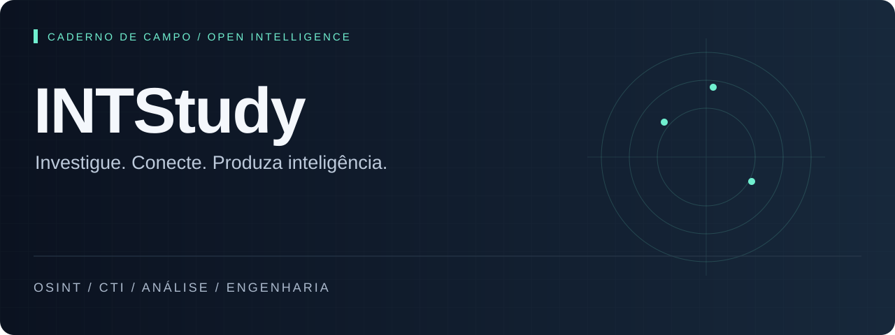
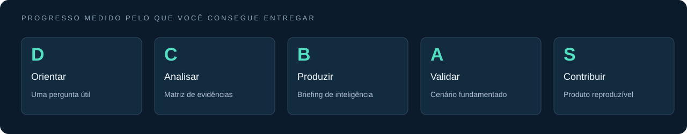
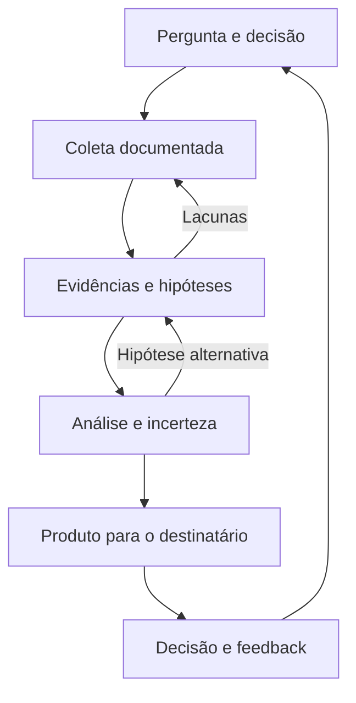

<p align="center"></p>

<p align="center">
<a href="COMECE-AQUI.md"><strong>COMEÇAR</strong></a> &nbsp; / &nbsp;
<a href="biblioteca/README.md"><strong>BIBLIOTECA</strong></a> &nbsp; / &nbsp;
<a href="landscape/README.md"><strong>RADAR</strong></a> &nbsp; / &nbsp;
<a href="trilhas/CTI-DO-ZERO-AO-BRIEFING.md"><strong>MISSÕES</strong></a> &nbsp; / &nbsp;
<a href="docs/MAPA-DISCIPLINAS.md"><strong>DISCIPLINAS</strong></a>
</p>

# Seu caderno de campo em inteligência

Estude **OSINT, CTI e análise de malware** conectando investigação, psicologia, dados e arquitetura. Cada percurso termina com algo que você consegue explicar, revisar e usar.

**Uma pergunta → evidências → uma avaliação → uma decisão.**

<table>
<tr>
<td width="50%" valign="top">
<h3>01 / Biblioteca aberta</h3>
<p>Escolha uma leitura pelo problema que precisa resolver. Fontes organizadas por disciplina, nível e finalidade.</p>
<p><a href="biblioteca/README.md"><strong>Explorar a biblioteca →</strong></a></p>
</td>
<td width="50%" valign="top">
<h3>02 / Radar de Landscape</h3>
<p>Compare séries de relatórios, bases de evidência e relevância para o Brasil. Identifique o que ainda falta saber.</p>
<p><a href="landscape/README.md"><strong>Abrir o radar →</strong></a></p>
</td>
</tr>
<tr>
<td width="50%" valign="top">
<h3>03 / Missões de CTI</h3>
<p>Seis missões para sair da pergunta e chegar a um briefing. Produza evidências, hipóteses e uma avaliação revisada.</p>
<p><a href="trilhas/CTI-DO-ZERO-AO-BRIEFING.md"><strong>Iniciar a jornada →</strong></a></p>
</td>
<td width="50%" valign="top">
<h3>04 / Caso Aurora</h3>
<p>Um laboratório documental fictício para praticar hipóteses concorrentes e decidir a próxima coleta.</p>
<p><a href="trilhas/CASO-AURORA.md"><strong>Abrir o caso →</strong></a></p>
</td>
</tr>
</table>

> [!TIP]
> **Tem 25 minutos?** Abra a [primeira sessão](COMECE-AQUI.md). Saia com uma pergunta respondível, uma evidência e a próxima ação.

## Escolha o que quer produzir

| Sua pergunta | Percurso | Entregável |
|:---|:---|:---|
| Como começar uma investigação? | [Primeira sessão](COMECE-AQUI.md) | Pergunta de inteligência |
| Como aplicar MITRE com contexto? | [MITRE / CTID](trilhas/MITRE-EM-CONTEXTO.md) | Relações entre comportamento, defesa e arquitetura |
| Como comparar tendências? | [Landscape / ENISA](trilhas/LANDSCAPE-E-TENDENCIAS.md) | Panorama temático com limitações |
| Onde encontrar relatórios? | [Observatório de acervos](biblioteca/LANDSCAPES-E-TENDENCIAS.md) | Seleção de fontes rastreável |
| Como escrever a análise? | [Templates](templates/README.md) | PIR, evidências, briefing e revisão |
| Como conectar outras áreas? | [19 disciplinas](docs/MAPA-DISCIPLINAS.md) | Um percurso entre investigação e engenharia |
| Qual projeto usar? | [Catálogo de repositórios](CATALOGO-REPOS.md) | Ferramenta escolhida pela finalidade |

## Progresso que você consegue demonstrar



**D → S é uma rubrica de estudo, não uma certificação.** Avance ao entregar um artefato e explicar suas limitações. Veja os [critérios da jornada](trilhas/CTI-DO-ZERO-AO-BRIEFING.md).

## A estante essencial

| Etapa | Referência aberta | Pergunta que ela ajuda a responder |
|:---|:---|:---|
| **Direção** | [FIRST · CTI Curriculum](https://www.first.org/global/sigs/cti/curriculum/) | Para quem produzimos inteligência e para qual decisão? |
| **Método** | [ENISA · Threat Landscape Methodology](https://www.enisa.europa.eu/publications/enisa-cybersecurity-threat-landscape-methodology) | Como delimitar e documentar uma pesquisa de ameaças? |
| **Análise** | [FIRST · Incerteza em CTI](https://www.first.org/global/sigs/cti/curriculum/cti-reporting) | O que julgamos provável e quão sólida é a evidência? |
| **Comportamento** | [CISA · ATT&CK Mapping](https://www.cisa.gov/news-events/news/best-practices-mitre-attckr-mapping) | Qual comportamento está realmente sustentado pela fonte? |
| **Produção** | [TIBER-EU · TTIR](https://www.ecb.europa.eu/pub/pdf/annex/ecb.tiber_targeted_threat_intelligence_report_guidance_2025.en.pdf) | Como conectar contexto, ameaças e cenários? |
| **Operação** | [MISP · Best Practices](https://www.misp-project.org/best-practices-in-threat-intelligence.html) | Como compartilhar e melhorar uma análise? |

**Comece pelas seis; use o [catálogo completo](biblioteca/README.md) para aprofundar.** A seleção é editorial, não um ranking de prestígio. Livros comerciais citados na pesquisa ficam no [arquivo de referências](biblioteca/REFERENCIAS-RESTRITAS.md), fora das trilhas abertas.

## Do dado à decisão



## Como estudar sem acumular links

1. **Defina a decisão.** Registre uma pergunta no [template de PIR](templates/PIR.md).
2. **Leia com objetivo.** Extraia uma ideia aplicável e uma limitação da fonte.
3. **Produza.** Preencha a [matriz de evidências](templates/EVIDENCIAS.md) e o [briefing](templates/BRIEFING.md).
4. **Revise.** Use a [rubrica](templates/REVISAO.md) e registre a próxima lacuna no [diário](DIARIO.md).

<details>
<summary><strong>Como funciona a curadoria?</strong></summary>

- Fonte única: [`biblioteca/fontes.json`](biblioteca/fontes.json).
- Organização por disciplina, finalidade, acesso, ano e nível.
- [Procedência](biblioteca/PROCEDENCIA.md): o que foi confirmado e o que continua incerto.
- [Registro desta pesquisa](docs/CURADORIA-2026-10-16.md): referências incorporadas, correções e critérios.
- [Verificação técnica](biblioteca/VERIFICACAO-LINKS.md): disponibilidade HTTP não prova qualidade, atualidade nem acesso integral.
- PDFs de terceiros permanecem nos sites dos autores. Acesso gratuito não concede automaticamente direito de redistribuição.

</details>

<details>
<summary><strong>Manutenção e contribuição</strong></summary>

```bash
python3 tools/catalogo.py --checar
python3 tools/biblioteca.py
python3 tools/biblioteca.py --checar
python3 tools/verificar_interno.py
```

Leia [CONTRIBUTING.md](CONTRIBUTING.md). Para dados e geração, Python stdlib é suficiente. O GitHub Actions confere a consistência dos índices e links locais.

</details>

## Princípios de trabalho

**Fonte antes da conclusão · contexto antes do indicador · hipóteses antes da atribuição · feedback depois da entrega.** Laboratórios usam casos sintéticos ou relatórios públicos. Inferências sobre pessoas exigem especial cuidado: comportamento observável não equivale a diagnóstico ou intenção comprovada.

Materiais de terceiros mantêm suas respectivas licenças. A declaração de licença do conteúdo autoral deve ser formalizada pelo mantenedor; a sugestão anterior de CC BY 4.0 não é tratada aqui como licença já concedida.

---

**INTStudy** · Curadoria de **Deivison Lourenço** · [@Ridd1kulusC0d3r](https://github.com/Ridd1kulusC0d3r)

[Começar](COMECE-AQUI.md) · [Contribuir](CONTRIBUTING.md) · [Procedência das fontes](biblioteca/PROCEDENCIA.md)
